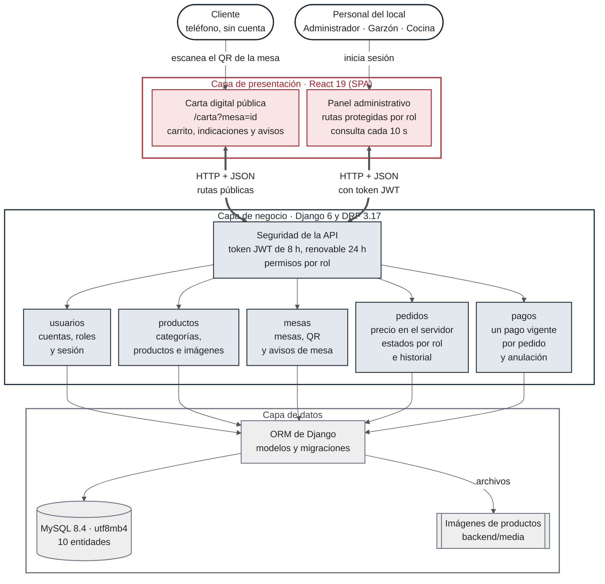

# Arquitectura en tres capas

El sistema sigue una arquitectura cliente-servidor en tres capas. Cada capa tiene una responsabilidad y se comunica solo con la capa vecina.

La fuente del diagrama, con sus estilos, es [`arquitectura-3-capas.mmd`](arquitectura-3-capas.mmd). Hay copias exportadas en [`arquitectura-3-capas.svg`](arquitectura-3-capas.svg) y [`arquitectura-3-capas.png`](arquitectura-3-capas.png).

## Capas

**Presentación** (`frontend/`). Es una aplicación de una sola página (SPA) en React 19, construida con Vite 8, con dos interfaces:
- La **carta digital** es pública: el cliente entra por el código QR de su mesa (`/carta?mesa=<id>`), arma su pedido con indicaciones y puede llamar al garzón o pedir la cuenta.
- El **panel administrativo** tiene rutas protegidas según el rol (`routes/ProtectedRoute.jsx`). Consulta los pedidos y los avisos de mesa cada 10 segundos; no hay notificaciones en tiempo real.

Las dos usan el mismo cliente HTTP (`services/api.js`, con Axios), que adjunta el token de sesión a cada petición del panel y lo renueva cuando vence.

**Negocio** (`backend/`). Es una API REST en Django 6 y Django REST Framework 3.17.
- **Seguridad.** Toda petición pasa primero por la autenticación con JSON Web Token (`djangorestframework-simplejwt`: acceso de 8 horas y refresco de 24, con rotación y lista negra) y por los permisos por rol de `config/permissions.py`.
- **Cinco aplicaciones.** `backend/apps/` tiene usuarios, productos, mesas, pedidos y pagos. Cada una trae sus modelos, serializadores, vistas y rutas.
- **Reglas del negocio en el servidor:**
  - el precio de cada pedido se calcula en el backend;
  - los estados del pedido avanzan en orden y según el rol (`TRANSICIONES` en `apps/pedidos/views.py`), y cada cambio queda en el historial;
  - cada pedido tiene a lo más un pago vigente: el cobro corre en una transacción que bloquea el pedido.

**Datos.** El ORM de Django traduce los modelos a tablas de MySQL 8.4 (`utf8mb4`) y versiona el esquema con migraciones. Las imágenes de los productos se guardan como archivos en `backend/media/`. El código QR de cada mesa se guarda en la base, como imagen PNG en base64.

## Recorrido de una petición

1. El navegador envía una petición HTTP con JSON. En el panel lleva el encabezado `Authorization: Bearer <token>`.
2. Django revisa el origen (CORS), autentica el token y verifica el permiso del rol para esa ruta.
3. La vista valida los datos con su serializador y aplica las reglas del negocio.
4. El modelo lee o escribe en MySQL mediante el ORM.
5. La respuesta vuelve en JSON.

Las rutas públicas no requieren token. Sirven para iniciar y renovar la sesión, leer las categorías, los productos y las mesas, crear pedidos y enviar avisos de mesa. Las 40 combinaciones de ruta y método, con el rol que puede usar cada una, están en la prueba `MatrizDePermisosTests` (`backend/config/tests.py`).
