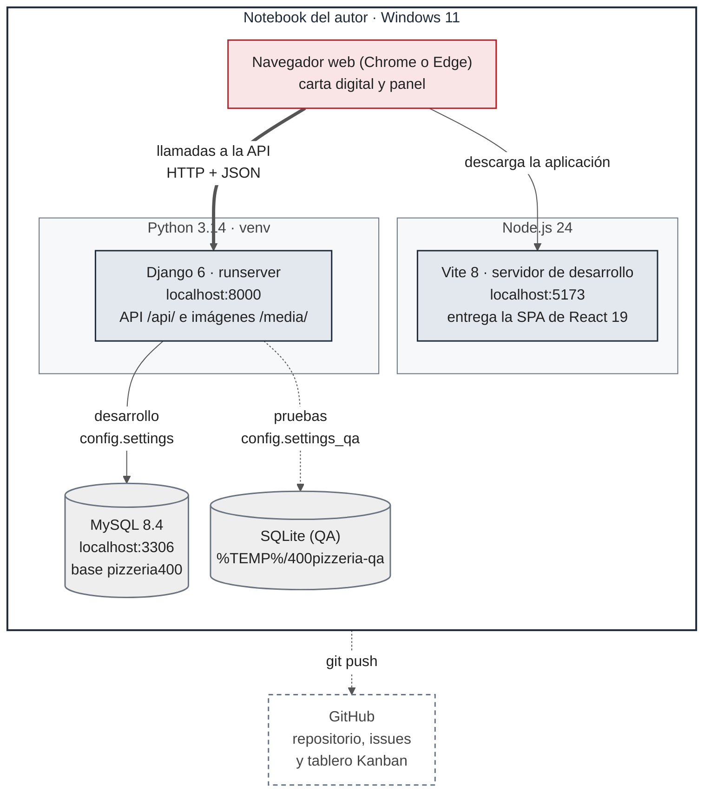

# Despliegue: dónde se ejecuta el sistema

El sistema **no está desplegado en un servidor de producción**. Se ejecuta en el notebook del autor, con dos configuraciones de Django: una de desarrollo y una de prueba (QA).

La fuente del diagrama, con sus estilos, es [`despliegue.mmd`](despliegue.mmd). Hay copias exportadas en [`despliegue.svg`](despliegue.svg) y [`despliegue.png`](despliegue.png).

## Procesos y configuraciones

| Proceso | Comando | Dirección |
|---|---|---|
| Frontend (desarrollo) | `npm run dev` en `frontend/` | `http://localhost:5173` |
| Backend | `python manage.py runserver` en `backend/` | `http://localhost:8000` |
| Base de datos de desarrollo | Servicio de MySQL 8.4 | `localhost:3306`, base `pizzeria400` |

- **Desarrollo:** `config.settings` lee las credenciales de MySQL desde `backend/.env` (ver `.env.example`).
- **Prueba (QA):** `config.settings_qa` usa SQLite y una carpeta de imágenes temporal en `%TEMP%/400pizzeria-qa`, para no tocar la base de desarrollo. Con esa configuración existen los comandos `cargar_datos_qa` y `medir_tiempos`. Las pruebas automatizadas usan una base SQLite en memoria.

El navegador descarga la aplicación desde Vite y después llama directamente a la API de Django. Las imágenes de los productos se sirven desde `/media/` solo con `DEBUG` activado.

## Limitación: hoy solo funciona en el mismo equipo

Todas las direcciones están fijas en `localhost`:
- `frontend/src/services/api.js` llama a la API en `http://localhost:8000/api`;
- `backend/config/settings.py` solo acepta `localhost` y `127.0.0.1` en `ALLOWED_HOSTS`, y solo `http://localhost:5173` en `CORS_ALLOWED_ORIGINS`;
- el servidor de Vite escucha solo en `localhost`.

Por eso, un teléfono que escanea el código QR de una mesa no puede abrir la carta ni llamar a la API: la carta y el panel funcionan solo en el navegador del mismo notebook. Para usar el sistema desde la red del local o desde un servidor, hay que hacer configurables esas direcciones con variables de entorno y, en un servidor, reemplazar `runserver` y Vite por un servidor de aplicaciones y los archivos compilados del frontend (`npm run build`).
